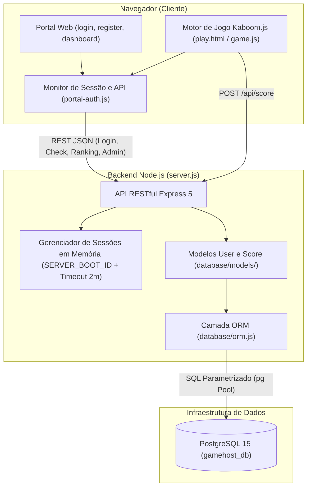

# Relatório Técnico do Projeto — DEVES: O Despertar do Mago

## 1. Visão Geral do Sistema
**DEVES: O Despertar do Mago** é uma aplicação web Full-Stack que integra um portal de gerenciamento de jogadores, sessões e rankings (Speedruns) a um jogo 2D de ação e plataforma em estilo *Dark Fantasy* construído com **Kaboom.js**.

O sistema é servido de forma unificada por uma aplicação **Node.js / Express**, responsável tanto pela entrega dos recursos estáticos (portal web e assets do jogo) quanto pelo fornecimento de uma **API RESTful** integrada ao banco de dados relacional **PostgreSQL** por meio de uma camada **ORM (Object-Relational Mapping)**.

---

## 2. Arquitetura e Stack Tecnológica

### 2.1. Linguagens e Ambientes
- **JavaScript (ES6+):** Linguagem principal utilizada em todas as camadas (Backend CommonJS e Frontend ES Modules).
- **HTML5 & CSS3:** Estruturação semântica e estilização temática (*Cinzel* e *Crimson Text*) das páginas do portal.
- **SQL (PostgreSQL 15):** Persistência relacional executada em container Docker (`database/docker-compose.yml`).

### 2.2. Diagrama de Arquitetura

---

## 3. Camada ORM e Modelagem de Dados

### 3.1. Implementação do ORM ([`database/orm.js`](file:///d:/Projeto%20Game/Castlevania-kaboom/database/orm.js))
Para abstrair o acesso ao banco de dados e eliminar consultas SQL manuais espalhadas pelas rotas HTTP, foi implementada uma camada ORM sobre o pacote `pg`:
- **Sincronização de Esquema (`orm.sync()`):** Inspeciona os atributos de cada modelo e executa automaticamente `CREATE TABLE IF NOT EXISTS` e `ALTER TABLE ... ADD COLUMN IF NOT EXISTS` ao iniciar o servidor.
- **Prevenção contra SQL Injection:** Todas as cláusulas `WHERE`, `INSERT` e `UPDATE` utilizam *placeholders* posicionais parametrizados (`$1, $2, ...`).
- **Operadores e Métodos de Consulta:** Suporte a `Model.create()`, `Model.findOne()`, `Model.findAll({ where, attributes, order, limit })`, `Model.update()`, `Model.destroy()` e operadores compostos como `Op.or`.

### 3.2. Modelos Relacionais ([`database/models/`](file:///d:/Projeto%20Game/Castlevania-kaboom/database/models/index.js))
1. **Modelo `User` ([`database/models/User.js`](file:///d:/Projeto%20Game/Castlevania-kaboom/database/models/User.js)) — Tabela `users`**:
   - `id` (`SERIAL PRIMARY KEY`)
   - `username` (`VARCHAR(50) UNIQUE NOT NULL`)
   - `email` (`VARCHAR(100) UNIQUE NOT NULL`)
   - `password_hash` (`VARCHAR(255) NOT NULL`) — Hash gerado com `bcrypt` (10 *salt rounds*).
   - `password_plain` (`VARCHAR(255)`) — Armazenado para auditoria exclusiva pelo administrador no painel restrito.
   - `created_at` (`TIMESTAMP DEFAULT CURRENT_TIMESTAMP`)
2. **Modelo `Score` ([`database/models/Score.js`](file:///d:/Projeto%20Game/Castlevania-kaboom/database/models/Score.js)) — Tabela `scores`**:
   - `id` (`SERIAL PRIMARY KEY`)
   - `username` (`VARCHAR(50) NOT NULL`) — Relacionamento `1:N` com `User`.
   - `status` (`VARCHAR(20) NOT NULL`) — `"VITORIA"` ou `"DERROTA"`.
   - `tempo_segundos` (`INTEGER NOT NULL`) — Tempo decorrido na partida em segundos.
   - `criado_em` (`TIMESTAMP DEFAULT CURRENT_TIMESTAMP`)

### 3.3. Proteção de Dados no Versionamento ([`.gitignore`](file:///d:/Projeto%20Game/Castlevania-kaboom/.gitignore))
O arquivo `.gitignore` foi configurado para impedir que volumes do PostgreSQL (`pgdata/`, `database/data/`), backups/dumps (`*.dump`, `*.sql.gz`, `*.bak`), bancos locais (`*.db`, `*.sqlite`) e variáveis sensíveis (`.env`) sejam salvos no repositório Git.

---

## 4. Especificação das APIs RESTful ([`server.js`](file:///d:/Projeto%20Game/Castlevania-kaboom/server.js))

| Método | Rota | Descrição Técnica |
| :--- | :--- | :--- |
| `POST` | `/api/register` | Valida campos obrigatórios, verifica duplicidade de `username` ou `email` via `User.findOne({ where: { [Op.or]: [...] } })`, gera hash `bcrypt` e cria o registro com `User.create()`. |
| `POST` | `/api/login` | Autentica o usuário via `User.findOne` e `bcrypt.compare`. Emite um `sessionToken` único e retorna o `serverBootId` da instância ativa do servidor. |
| `POST` | `/api/session/check` | Verifica se o `serverBootId` coincide com a instância atual do servidor e se a sessão não ultrapassou o limite de 2 minutos de inatividade/aba fechada. |
| `POST` | `/api/session/tab-close` | Recebe notificação assíncrona (`navigator.sendBeacon`) quando o usuário fecha a aba, iniciando a contagem do prazo de tolerância de 2 minutos. |
| `POST` | `/api/logout` | Remove imediatamente o `sessionToken` do mapa `activeSessions`. |
| `POST` | `/api/score` | Registra o resultado da partida enviado pelo Kaboom.js usando `Score.create()`. |
| `GET` | `/api/scores` | Retorna os **10 melhores tempos globais** filtrando `where: { status: 'VITORIA' }` e ordenando por `[['tempo_segundos', 'ASC'], ['criado_em', 'ASC']]`. |
| `GET` | `/api/scores/user/:username` | Retorna as últimas 5 partidas (`VITORIA` ou `DERROTA`) do jogador autenticado, ordenadas por `[['criado_em', 'DESC']]`. |
| `GET` | `/api/admin/users` | Rota protegida que valida o cabeçalho `x-session-token` e permite acesso **somente** ao administrador `overlord 1` (retornando `403 Forbidden` para qualquer outro usuário). |

---

## 5. Segurança de Sessão e Controle de Acesso

1. **Invalidação de Sessão ao Fechar o Servidor:**
   - Na inicialização do `server.js`, é gerado em memória o identificador `SERVER_BOOT_ID = crypto.randomUUID()`.
   - O script [`portal-auth.js`](file:///d:/Projeto%20Game/Castlevania-kaboom/web/js/portal-auth.js) executa um *heartbeat* a cada 3 segundos nas páginas `dashboard.html` e `play.html`.
   - Caso o servidor seja encerrado, o jogo é imediatamente interrompido na tela e a sessão local é apagada; quando o servidor volta a ficar online, o usuário é redirecionado automaticamente para `/login.html`.
2. **Tolerância de 2 Minutos ao Fechar a Aba:**
   - Ao fechar ou sair da aba (`pagehide` / `beforeunload`), o cliente grava `tabClosedAt` e notifica `/api/session/tab-close`.
   - Se o jogador reabrir a aba em **até 2 minutos** (e o servidor não tiver sido reiniciado), sua sessão é preservada sem exigir novo login.
   - Caso passem **mais de 2 minutos** (`120.000 ms`), tanto o cliente quanto o servidor invalidam a sessão e exigem novo login.
3. **Permissão Exclusiva de Administrador (`overlord 1`):**
   - A função `isUsuarioAdmin(username)` garante que apenas `overlord 1` visualize o botão **👑 Painel Admin (Usuários)** no Dashboard e tenha autorização na API `/api/admin/users`.

---

## 6. Engenharia do Jogo 2D (Kaboom.js)

### 6.1. Carregamento e Otimização de Mapas ([`frontend/js/mapa.js`](file:///d:/Projeto%20Game/Castlevania-kaboom/frontend/js/mapa.js))
- **Divisão em Chunks (`1024x1024 px`):** Em vez de criar milhares de objetos individuais de tile, as camadas visuais do Tiled (`.tmj`) são pré-desenhadas em *canvases* de `1024x1024` pixels e cacheadas em memória.
- **Mesclagem de Sólidos e Extração de Rampas:** Tiles adjacentes da camada `solidos` são fundidos em retângulos únicos (`mesclarSolidos`), enquanto degraus de até 16px são convertidos em rampas poligonais suaves (`extrairRampas` + simplificação de linha de Douglas-Peucker).

### 6.2. Cenas, Entidades e Mecânicas ([`frontend/js/cenas/game.js`](file:///d:/Projeto%20Game/Castlevania-kaboom/frontend/js/cenas/game.js))
- **Jogador ([`jogador.js`](file:///d:/Projeto%20Game/Castlevania-kaboom/frontend/js/entidades/jogador.js)):** Possui hitbox poligonal estreita nos pés para caminhar suavemente em rampas, ataque lateral com espada (`Z`), golpe aéreo para baixo com impulso (`Z + Baixo`), disparo de bola de fogo com consumo de mana (`X`) e voo temporário ou infinito com o item Asas (`S`).
- **Inimigos e Chefes (`entidades/`):**
  - **Esqueletos (`esqueletos.js`):** Ao terem o HP zerado, desmontam em uma pilha de ossos e revivem após 10 segundos.
  - **Lobos (`lobo.js`) e Corvos (`corvos.js`):** Patrulha terrestre veloz e voo senoidal entre zonas de folhagem com explosão no impacto.
  - **Guardião Mascarado (`guardiao.js`):** Chefe de 2 fases da Floresta (`level-1`). Ao atingir 50% de vida, perde a máscara e passa a executar saltos teleguiados com dano de impacto no pouso.
  - **Lich (`lich.js`):** Chefe final da Caverna (`level-2`), alternando entre projéteis sombrios com áudio espacial e feixes de raio verticais precedidos por aviso luminoso.
- **Cronômetro e Modo de Teste (`godmod`):**
  - O cronômetro na HUD contabiliza apenas o tempo efetivo de jogo (pausando no menu `ESC`) e persiste na transição da Fase 1 para a Fase 2.
  - Digitar **`godmod`** no menu ou durante a partida ativa imortalidade completa e o item **Asas** com tempo de voo infinito desde o início para validação e testes rápidos das mecânicas.
